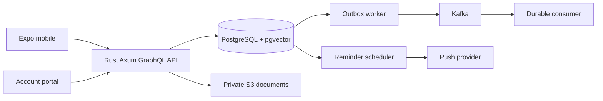

# Architecture

Target architecture; components are working only when progress.md records verification. Modular Rust application, separate API/worker processes. All domain mutations and events share transactions. Future schedules and retry times live in PostgreSQL. No Redis, RabbitMQ, AI or learned embeddings.

Money uses integer minor units with currency-specific precision. Currency totals remain separate. Date-only deadlines require an explicit IANA timezone and user-confirmed cutoff; instants use UTC. Server ownership and optimistic versions are mandatory. Mobile credentials belong in SecureStore.
